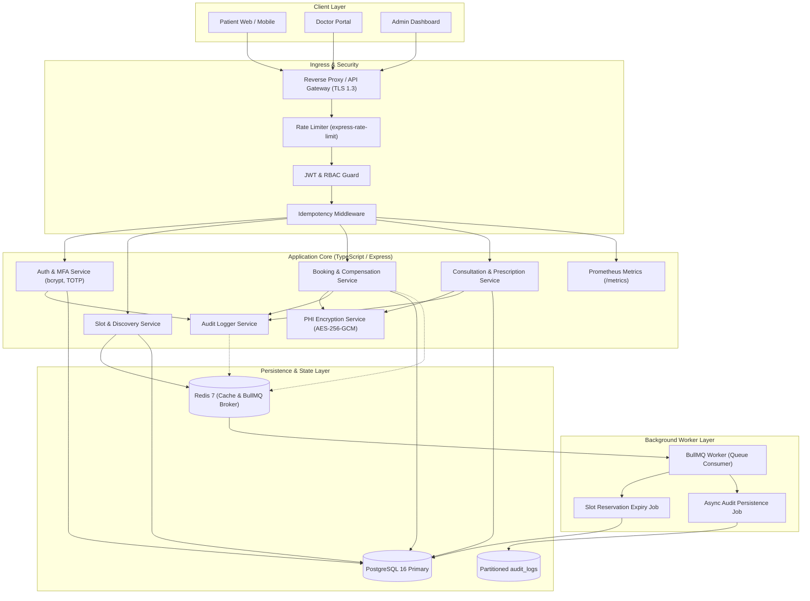
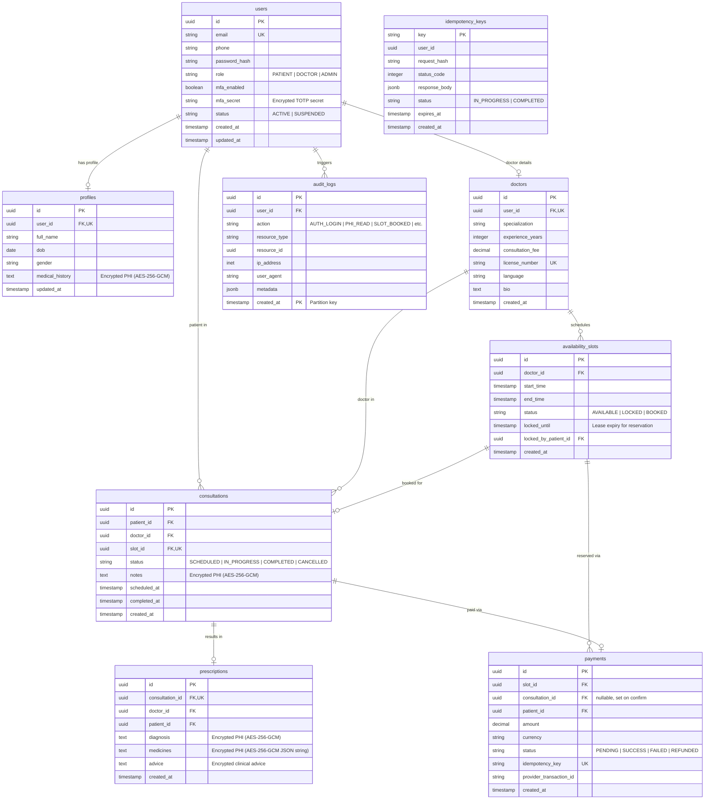

# System Architecture Document — Telemedicine Backend

> **Target SLA & Scale:** 100,000 daily consultations | p95 < 200ms reads | p95 < 500ms writes | 99.95% Availability | Zero Double-Booking | Strict Idempotency

---

## 1. High-Level Architecture & Component Data Flow

The system is architected as a modular, layered service deployed as a containerized Node.js (TypeScript) application backed by PostgreSQL (primary relational store with declarative partitioning) and Redis (caching and asynchronous queue broker).



### Architectural Principles:
1. **Layered Separation of Concerns:** Controllers handle HTTP input/output schema validation; Services encapsulate pure domain logic; Repositories isolate direct SQL queries.
2. **Dependency Injection:** Services and repositories are passed explicitly to constructors, enabling mock-based testing without monkey patching.
3. **Defense in Depth:** Input validation (Zod) $\to$ Rate Limiting $\to$ JWT Authentication $\to$ Role Guard $\to$ Idempotency Check before business execution.

---

## 2. High-Concurrency Booking Flow & Sequence Diagram

Booking collisions under peak load (e.g., flash booking or high-demand specialists) are handled using **pessimistic row-level locking (`SELECT FOR UPDATE NOWAIT`)** combined with a `locked_until` lease mechanism.

```mermaid
sequenceDiagram
    autonumber
    actor Patient as Patient Client
    participant API as Booking Controller
    participant Idemp as Idempotency Engine
    participant BookSvc as Booking Service
    participant DB as PostgreSQL Transaction
    participant Gateway as Mock Payment Gateway
    participant Worker as BullMQ Expiry Worker

    Patient->>API: POST /api/v1/bookings/reserve (Idempotency-Key, slot_id)
    API->>Idemp: Check & lock Idempotency-Key
    alt Key already completed
        Idemp-->>Patient: Return cached response (Replay)
    end

    API->>BookSvc: executeReservation(patient_id, slot_id)
    BookSvc->>DB: BEGIN Transaction
    BookSvc->>DB: SELECT * FROM availability_slots WHERE id = $1 FOR UPDATE NOWAIT
    
    alt Slot is locked by concurrent request (Lock Conflict)
        DB-->>BookSvc: Error: 55P03 (lock_not_available)
        BookSvc->>DB: ROLLBACK
        BookSvc-->>Patient: 409 Conflict ("Slot is currently being booked by another user")
    else Slot is AVAILABLE or previous lock expired (now() > locked_until)
        BookSvc->>DB: UPDATE availability_slots SET status = 'LOCKED', locked_until = now() + INTERVAL '10 min'
        BookSvc->>DB: INSERT INTO payments (status='PENDING', amount=fee)
        BookSvc->>DB: COMMIT Transaction
        BookSvc-->>API: Reservation Confirmed (reservation_id, expires_at)
        API->>Idemp: Cache response with Idempotency-Key
        API-->>Patient: 201 Created (slot locked for 10 minutes)
    end

    Note over Patient,Worker: Scenario A: Patient completes payment within 10 min
    Patient->>API: POST /api/v1/bookings/confirm (Idempotency-Key, reservation_id)
    API->>BookSvc: confirmBooking(reservation_id)
    BookSvc->>DB: Check slot is LOCKED by this patient AND locked_until > now()
    BookSvc->>Gateway: Charge (outside DB transaction)
    alt Charge declined or timeout
        BookSvc->>DB: Compensate: payment FAILED, slot AVAILABLE, locked_until NULL
        BookSvc-->>Patient: 400 Payment failed
    else Charge succeeded
        BookSvc->>DB: BEGIN Transaction
        BookSvc->>DB: UPDATE payments SET status='SUCCESS'
        BookSvc->>DB: UPDATE availability_slots SET status='BOOKED', locked_until=NULL
        BookSvc->>DB: INSERT INTO consultations (status='SCHEDULED')
        BookSvc->>DB: UPDATE payments SET consultation_id = new consultation id
        BookSvc->>DB: COMMIT Transaction
        BookSvc-->>Patient: 200 OK (Consultation Booked)
    end

    Note over DB,Worker: Scenario B: Patient abandons checkout (Timeout)
    Worker->>DB: Sweep expired locks: status='LOCKED' AND locked_until < now()
    Worker->>DB: Compensate: SET status='AVAILABLE', locked_until=NULL; cancel PENDING payments
```

---

## 3. Entity-Relationship (ER) Data Model

The data architecture comprises **8 core domain tables** plus the operational `idempotency_keys` table.



---

## 4. API Schema Summary

The REST API uses OpenAPI 3.0 standards, JSON payloads, and standard HTTP response codes.

| Module | Method & Path | Purpose | Access Control |
|---|---|---|---|
| **Auth** | `POST /api/v1/auth/register` | Register new Patient or Doctor account | Public |
| **Auth** | `POST /api/v1/auth/login` | Authenticate & issue JWT access/refresh token | Public |
| **Auth** | `POST /api/v1/auth/refresh` | Exchange refresh token for new access token | Public |
| **Auth** | `POST /api/v1/auth/mfa/setup` | Generate TOTP secret & QR setup URI | Authenticated |
| **Auth** | `POST /api/v1/auth/mfa/verify` | Validate 6-digit TOTP code & activate MFA | Authenticated |
| **Profiles** | `GET /api/v1/users/profile` | Retrieve profile (decrypts PHI) | Authenticated |
| **Profiles** | `PUT /api/v1/users/profile` | Update profile (encrypts PHI) | Authenticated |
| **Profiles** | `PUT /api/v1/doctors/profile` | Doctor sets specialization, fee, language | Doctor Only |
| **Discovery** | `GET /api/v1/doctors/search` | Fast search by specialization, language, fee | Public / Patient |
| **Slots** | `POST /api/v1/slots` | Doctor creates single consultation slot | Doctor Only |
| **Slots** | `GET /api/v1/slots?doctor_id=...` | List available slots (Redis cached) | Public / Patient |
| **Booking** | `POST /api/v1/bookings/reserve` | Concurrency-safe slot lock with `Idempotency-Key` | Patient Only |
| **Booking** | `POST /api/v1/bookings/confirm` | Finalize booking & mocked payment | Patient Only |
| **Consult** | `GET /api/v1/consultations/:id` | Read consultation | Patient / Doctor / Admin |
| **Consult** | `PATCH /api/v1/consultations/:id/status` | State transition (`IN_PROGRESS`, `COMPLETED`) | Doctor / Admin |
| **Prescribe** | `POST /api/v1/prescriptions` | Create digital prescription (encrypted) | Doctor Only |
| **Prescribe** | `GET /api/v1/prescriptions/:id` | Read prescription (decrypted) | Patient / Doctor |
| **Telemetry** | `GET /health/live`, `/health/ready` | Liveness & Readiness checks | Public / Orchestrator |
| **Telemetry** | `GET /metrics` | Prometheus metrics scrape endpoint | Monitoring / Internal |
| **Analytics**| `GET /api/v1/admin/analytics/overview` | Platform consultation & financial stats | Admin Only |

---

## 5. Retry and Exponential Backoff Strategy

Distributed network operations (payment gateway calls, database connection acquisition, external services) follow a **Full Jitter Exponential Backoff algorithm**:

$$T_{wait} = \text{random}(0, \min(T_{max}, T_{base} \times 2^{\text{attempt}}))$$

### Concrete Policy Table:
| Operation Type | Max Attempts | Base Backoff ($T_{base}$) | Max Cap ($T_{max}$) | Retryable Errors |
|---|---|---|---|---|
| **DB Connection Pool** | 3 | 50ms | 1000ms | Connection timeout, `ECONNRESET`, deadlock (40P01) |
| **Lock Contention (`55P03`)** | 0 (No retry) | N/A | N/A | Fail immediately with `409 Conflict` to preserve p95 SLA |
| **Mock Payment Gateway** | 2 | 200ms | 2000ms | 502, 503, 504 network timeouts; Never retry on 4xx card declines |
| **Async Audit Flush** | 5 | 500ms | 30000ms | Any I/O failure (queued in Redis dead-letter queue) |

---

## 6. Data Partitioning Strategy

### Implemented: Monthly Declarative Partitioning on `audit_logs`
* **Rationale:** At 100k daily consultations, security audit records generate $\approx 500{,}000$ to $1{,}000{,}000$ rows per day. A monolithic table would degrade index performance within months.
* **Partition Key:** `created_at` timestamp.
* **Mechanism:**
  ```sql
  CREATE TABLE audit_logs (
      id UUID NOT NULL,
      user_id UUID,
      action VARCHAR(64) NOT NULL,
      resource_type VARCHAR(64) NOT NULL,
      resource_id UUID,
      ip_address INET,
      user_agent TEXT,
      metadata JSONB,
      created_at TIMESTAMPTZ NOT NULL,
      PRIMARY KEY (id, created_at)
  ) PARTITION BY RANGE (created_at);

  -- Partition for October 2026
  CREATE TABLE audit_logs_y2026m10 PARTITION OF audit_logs
      FOR VALUES FROM ('2026-10-01 00:00:00+00') TO ('2026-11-01 00:00:00+00');
  ```
* **Performance Gain:** Queries filtering audit trails by date execute **Partition Pruning**, eliminating 90%+ of disk scans. Old partitions can be archived to cold storage via table detach without table locks.

### Future Scale-Out: `consultations` Partitioning
* When total historical consultations exceed 10 million rows, `consultations` can be partitioned using the identical monthly range strategy on `created_at`. In the current phase, composite B-tree indexes `(patient_id, scheduled_at)` and `(doctor_id, scheduled_at)` maintain sub-10ms query times.

---

## 7. Caching and Concurrency Handling

### Two-Tier Read Architecture (p95 < 200ms)
1. **L1 Application Index:** PostgreSQL composite indexes on frequently filtered columns:
   * `idx_doctors_filter`: `(specialization, language, consultation_fee)`
   * `idx_slots_active`: `(doctor_id, start_time) WHERE status = 'AVAILABLE'`
2. **L2 Redis Cache:**
   * Active doctor directory: key `cache:doctors:spec:<specialization>:lang:<lang>:fee:<max_fee>:page:<page>:limit:<limit>`, TTL = 5 minutes.
   * Doctor available slots: key `cache:slots:doctor:<doctor_id>`, TTL = 60 seconds.
   * **Cache Invalidation:** Invalidate slot cache immediately when a slot is created or changes status (`LOCKED`/`BOOKED`).

### Strict Concurrency (Zero Double-Booking)
* Handled exclusively via PostgreSQL ACID row-level locking:
  ```sql
  SELECT id, status, locked_until 
  FROM availability_slots 
  WHERE id = $1 
  FOR UPDATE NOWAIT;
  ```
* If status is `AVAILABLE` OR (`status = 'LOCKED'` AND `locked_until < now()`), the transaction proceeds to set `status = 'LOCKED'` and lease `locked_until = now() + INTERVAL '10 min'`.
* Concurrent requests fail immediately with SQL state `55P03` (lock not available), returning HTTP `409 Conflict`. Zero split-brain, zero double-booking.

---

## 8. Transaction Management & Booking Service Compensation

The booking lifecycle follows a linear transaction chain with explicit compensation steps:

```
[Step 1: Lock Slot] ──> [Step 2: Init Payment] ──> [Step 3: Gateway Charge] ──> [Step 4: Confirm Consultation]
        │                       │                          │
        ▼ (Error/Timeout)       ▼ (Error/Timeout)          ▼ (Declined/Timeout)
  [Compensate 1]          [Compensate 2]             [Compensate 3]
  Release lock to         Mark payment FAILED        Rollback slot to AVAILABLE
  AVAILABLE immediately   Release slot lock          Record failed payment in audit
```

### Compensation Implementation:
1. **Short Checkout Window:** Slot reservation writes `locked_until = now() + INTERVAL '10 min'`.
2. **Synchronous Failure:** If the payment gateway call throws an error or card decline, the service catches the exception, updates `payments.status = 'FAILED'`, clears `locked_until`, and updates slot status back to `AVAILABLE`.
3. **Asynchronous Timeout Sweeper:** A lightweight BullMQ recurring worker checks every minute:
   ```sql
   UPDATE availability_slots 
   SET status = 'AVAILABLE', locked_until = NULL, locked_by_patient_id = NULL
   WHERE status = 'LOCKED' AND locked_until < now();
   ```

---

## 9. Backup and Disaster Recovery (DR) Strategy

| Dimension | Target Specification | Operational Implementation |
|---|---|---|
| **Recovery Point Objective (RPO)** | **< 5 minutes** | PostgreSQL continuous Write-Ahead Log (WAL) archiving to secondary encrypted storage. |
| **Recovery Time Objective (RTO)** | **< 15 minutes** | Automated container restart via Docker Compose; rapid restore script from latest base backup + WAL replay. |
| **Base Backup Frequency** | **Daily at 02:00 UTC** | Automated `pg_dump` / `pg_basebackup` compressed, encrypted with GPG, and archived with a 30-day retention window. |
| **Redis Persistence** | **AOF + RDB** | Redis configured with `appendonly yes` (AOF fsync every second) + snapshot every 15 minutes. |
| **Disaster Failover Runbook** | 1. Spin up standby PostgreSQL instance.<br>2. Restore latest base backup.<br>3. Replay WAL segments up to target timestamp.<br>4. Re-point connection pool `DATABASE_URL` and restart backend containers. |
