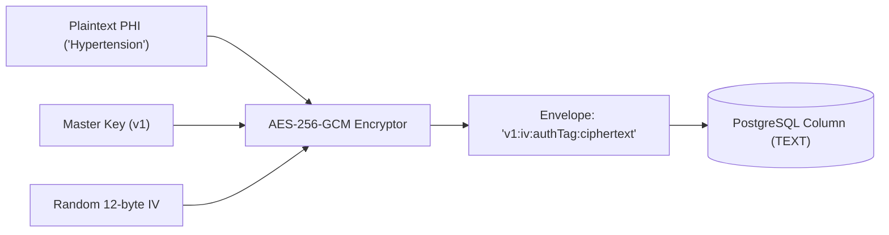

# Security Checklist & Threat Model — Telemedicine Backend

> **Standards & Compliance:** STRIDE Threat Analysis | OWASP API Top 10 (2023) | AES-256-GCM PHI Field-Level Encryption | RBAC & TOTP MFA | Immutable Audit Trails

---

## 1. STRIDE Threat Model & Attack Surface Analysis

The STRIDE methodology is applied to identify threats across all system boundaries:

| STRIDE Category | Threat Description | Attack Vector | Engineering Mitigation |
|---|---|---|---|
| **Spoofing** | Attacker impersonates a doctor to view patient consultations or issue prescriptions. | Stolen JWT or forged token. | - Short-lived access tokens (15m).<br>- Strong bcrypt password hashing (work factor 12).<br>- Mandatory TOTP MFA for Doctor accounts.<br>- Strict JWT signature verification with secret key. |
| **Tampering** | Malicious actor modifies appointment fee or amends medical diagnosis. | Parameter tampering in transit or API payload. | - TLS 1.3 encryption in transit.<br>- Strict Zod input schema validation.<br>- Fees verified strictly against database doctor profile (never trusted from client body). |
| **Repudiation** | Doctor denies writing a prescription or Admin denies changing permissions. | Lack of immutable audit records. | - Append-only, partitioned `audit_logs` table.<br>- Records user ID, exact action, target resource, client IP, and timestamp for all sensitive mutations. |
| **Information Disclosure** | Database dump exposed through backup breach; patient PHI leaked. | Stolen raw SQL backup or unauthorized DB access. | - **Field-level encryption** on sensitive medical columns using AES-256-GCM.<br>- Raw database only contains ciphertext (`v1:iv:tag:ciphertext`).<br>- DB credentials strictly segregated via environment variables. |
| **Denial of Service** | Flash bot requests flood slot booking to exhaust connection pool or lock slots. | Distributed parallel booking requests. | - Rate limiting via `express-rate-limit`.<br>- Slot locks bounded by a 10-minute expiry lease (`locked_until`).<br>- Connection pool limits (max 20 clients per container). |
| **Elevation of Privilege** | Patient crafts API request to access doctor-only prescription creation. | IDOR / Broken Function Level Authorization. | - Strict role-guard middleware (`requireRole('DOCTOR')`).<br>- Object-level ownership check verifying `patient_id` or `doctor_id` matches the token subject. |

---

## 2. OWASP API Security Top 10 (2023) Mitigation Matrix

| OWASP Vulnerability | Vulnerability Description | Telemedicine Backend Mitigation |
|---|---|---|
| **API1:2023 Broken Object Level Authorization (BOLA)** | User accesses records belonging to another patient/doctor by guessing UUID. | All consultation and prescription endpoints verify that `req.user.id` equals `patient_id` OR `doctor_id` OR user role is `ADMIN`. |
| **API2:2023 Broken Authentication** | Credential stuffing, weak passwords, brute force. | - Bcrypt hashing with salt factor 12.<br>- Rate limiting on `/api/v1/auth/login` (5 attempts per minute).<br>- TOTP MFA (RFC 6238) support. |
| **API3:2023 Broken Object Property Level Authorization** | Mass assignment allowing patient to set `role = 'ADMIN'` or `status = 'BOOKED'`. | Explicit DTO / schema filtering with Zod; unexpected fields are strictly stripped (`strip` mode). |
| **API4:2023 Unrestricted Resource Consumption** | Rapid requests exhausting memory or DB threads. | - IP-based rate limiting.<br>- Pagination enforced on list endpoints (default 20, max 100).<br>- Redis cache offloads search queries. |
| **API5:2023 Broken Function Level Authorization (BFLA)** | Regular user calling administrative or doctor-only endpoints. | Role-Based Access Control (`requireRole`) enforced before controller execution. |
| **API6:2023 Unrestricted Access to Sensitive Business Flows** | Scalpers bot-locking all doctor slots in seconds. | Universal `Idempotency-Key` requirement + row-level lock contention handling (`55P03`). |
| **API7:2023 Server Side Request Forgery (SSRF)** | Exploiting backend fetch calls to access internal metadata services. | The backend does not fetch arbitrary external URLs; all gateway calls are strictly hardcoded to configured endpoints. |
| **API8:2023 Security Misconfiguration** | Verbose error stack traces leaked in production. | Global error handler sanitizes outputs: returns generic error messages in production while logging detailed traces to Pino internally. |
| **API9:2023 Improper Inventory Management** | Zombie or undocumented endpoints exposed without guards. | Automated OpenAPI 3.0 specification (`openapi.yaml`) synchronized with API routes. |
| **API10:2023 Unsafe Consumption of APIs** | Blindly trusting 3rd-party payment callbacks. | Strict signature and idempotency verification on payment endpoints. |

---

## 3. Data Classification Matrix

To comply with healthcare data privacy and minimize breach exposure, data is categorized into 4 tiers:

| Tier | Category | Example Fields | Storage Requirements | Access Controls |
|---|---|---|---|---|
| **Tier 1** | **Public** | Doctor name, specialization, bio, consultation fee, slot availability times. | Plaintext in PostgreSQL + Redis Cache. | Unrestricted read access. |
| **Tier 2** | **Internal** | User IDs, creation timestamps, audit log metadata, payment transaction IDs. | Plaintext in PostgreSQL. | Authenticated system services and Admins. |
| **Tier 3** | **Confidential** | User email, phone number, hashed password, TOTP secret. | Password hashed with bcrypt; TOTP secret encrypted with AES-256-GCM; email and phone stored in plaintext (needed for login lookup); never returned in list APIs. | Owner only; Admins with audit logging. |
| **Tier 4** | **Restricted PHI (Protected Health Information)** | Medical history, patient diagnosis, prescription advice, medications. | **Field-level encrypted (AES-256-GCM)**; Decrypted strictly in memory upon authorized request. | Treating Doctor, Patient owner, and explicit Audit Trail. |

---

## 4. Field-Level Encryption & Key Rotation Specification

All Tier 4 PHI fields (`profiles.medical_history`, `prescriptions.diagnosis`, `prescriptions.medicines`, `prescriptions.advice`, `consultations.notes`) and the TOTP secret (`users.mfa_secret`) are encrypted before database insertion using **AES-256-GCM (Galois/Counter Mode)**.

### Encryption Envelope Format:
```
v<version>:<hex(iv)>:<hex(auth_tag)>:<hex(ciphertext)>
```
* **Version (`v1`):** Indicates the active encryption key identifier, enabling seamless key rotation.
* **Initialization Vector (IV):** Cryptographically secure random 12 bytes (96 bits) generated uniquely per encryption call (`crypto.randomBytes(12)`).
* **Auth Tag:** 16-byte (128-bit) GCM authentication tag ensuring data integrity and authenticity.
* **Ciphertext:** AES-256 encrypted string.



### Key Rotation Procedure:
1. **New Key Deployment:** A new key is generated and configured with identifier `v2` in environment variables:
   * `PHI_ENCRYPTION_KEY_V1=...`
   * `PHI_ENCRYPTION_KEY_V2=...`
   * `ACTIVE_PHI_KEY_VERSION=v2`
2. **Dual-Read Capability:** Decryption reads the version prefix (`v1` or `v2`) and selects the matching secret key.
3. **Write Forward:** All new writes and updates automatically encrypt using the active key (`v2`).
4. **Background Re-encryption:** A migration script reads any records starting with `v1:`, decrypts with `v1`, re-encrypts with `v2`, and updates the table.
5. **Key Retirement:** Once all rows are migrated to `v2`, `PHI_ENCRYPTION_KEY_V1` is safely retired.

---

## 5. Transport Security & Network Guidelines

* **TLS 1.3 Enforcement:** All external traffic terminates at the reverse proxy with TLS 1.3 enforced and legacy ciphers disabled.
* **HTTP Security Headers (via Helmet):**
  * `Strict-Transport-Security: max-age=63072000; includeSubDomains; preload`
  * `X-Content-Type-Options: nosniff`
  * `X-Frame-Options: DENY`
  * `Content-Security-Policy: default-src 'none'`
* **Zero Secrets in Code:** Passwords, JWT secrets, and encryption keys are injected exclusively via environment variables validated at process startup.

---

## 6. Attack Surface

- Public endpoints: register, login, refresh, doctor search, slot listing
- Authenticated endpoints: profile, booking, consultations, prescriptions (PHI)
- Admin endpoints: analytics
- Infrastructure: PostgreSQL, Redis, database backups, environment secrets
- Operational endpoints: /metrics and /health (restrict to internal network in production)

## 7. Dependency Scanning

`npm audit --audit-level=high` runs in the GitHub Actions CI pipeline on every push.
The build fails if a high or critical vulnerability is found.

## 8. Audit Logging Policy

- Events logged: login, MFA changes, PHI read/write, slot reservation, payment result, consultation status change.
- Fields: user_id, action, resource_type, resource_id, ip_address, user_agent, timestamp.
- Immutability: a database trigger blocks UPDATE and DELETE on audit_logs.
- Retention: monthly partitions; old partitions are archived, not deleted.

```sql
CREATE FUNCTION audit_logs_immutable() RETURNS trigger AS $$
BEGIN RAISE EXCEPTION 'audit_logs is append-only'; END;
$$ LANGUAGE plpgsql;

CREATE TRIGGER trg_audit_logs_immutable
BEFORE UPDATE OR DELETE ON audit_logs
FOR EACH ROW EXECUTE FUNCTION audit_logs_immutable();
```
